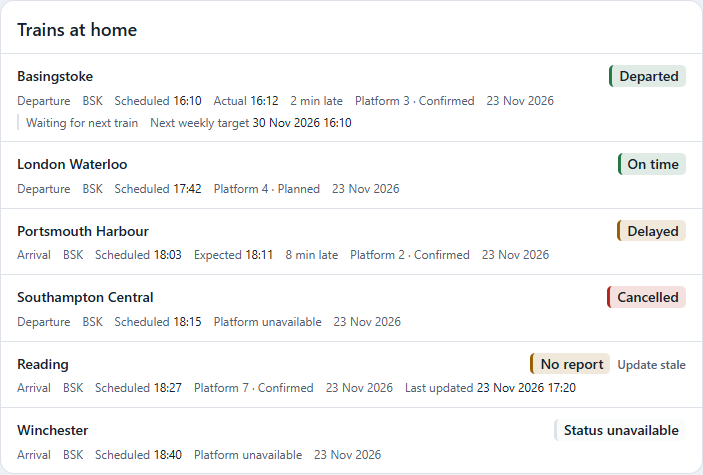

# Realtime Trains Card

A compact Home Assistant dashboard card for the [Realtime Trains integration](https://github.com/c-scoot/ha-rtt). Shows selected, dated station arrivals and departures, their reported status, scheduled/expected/actual times, delay, platform certainty, and stale readings.

Version **0.1.0** is the first release. Automated and browser checks use simulated Home Assistant data; installation on a live HA dashboard has not yet been verified.



## Install with HACS

Add `https://github.com/c-scoot/ha-rtt-card` as a **custom repository** in HACS, category **Dashboard**, and download **Realtime Trains Card**. Reload the dashboard and add **Realtime Trains** from the card picker. Select the train status sensors you want to display. Default-store listing is a separate submission and is not implied. HACS installation remains to be field-tested.

## Install manually

1. Install and configure the Realtime Trains integration, then select trains in its Configure menu.
2. Download `rtt-card.js` from [the latest release](https://github.com/c-scoot/ha-rtt-card/releases/latest), or use `dist/rtt-card.js` from this project, and copy it into `www/rtt-card.js` in your Home Assistant configuration directory. Create `www` if needed.
3. In dashboard Resources, add `/local/rtt-card.js?v=0.1.0` with type **JavaScript module**. Resources may require Advanced Mode in your HA user profile. If using YAML dashboard resources, declare the same URL as a module there.
4. Reload the dashboard, add **Realtime Trains** from the card picker, and choose the monitored status sensors. Use the editor to set a title, train names, and display order.

The card reads `hass.states`, `hass.entities`, and `hass.devices`. It makes no direct network calls and needs no RTT credentials. It targets the integration's HA 2025.8+ contract; the local build uses modern browser JavaScript.

## Configuration

```yaml
type: custom:rtt-card
title: Trains at home
trains:
  - entity: sensor.your_departure_status
    name: London Waterloo
  - entity: sensor.your_arrival_status
    name: Portsmouth Harbour
```

Replace the example entity IDs with your integration's **Status** sensors. The configured order is preserved. An empty `trains: []` is supported. Editing the card only changes its display; add or remove monitored services through the integration.

Each tracked station call is one integration device. Companion sensors are matched by device and integration role, so renaming entity IDs does not break sibling lookup. Selecting a renamed status sensor still requires updating that anchor in the card config if HA has not updated the reference. The same service's arrival and departure remain separate rows.

The default label is the integration device name, treated as opaque text. It can contain a platform captured when the train was selected. Set a display `name` for a concise route label and use the separate live platform label for the current reading.

If registry information is absent, map companion sensors explicitly in YAML:

```yaml
type: custom:rtt-card
trains:
  - entity: sensor.my_train_status
    name: My evening train
    sensors:
      scheduled: sensor.my_train_scheduled
      expected: sensor.my_train_expected
      actual: sensor.my_train_actual
      delay_minutes: sensor.my_train_delay
      platform: sensor.my_train_platform
      last_success: sensor.my_train_last_success
```

Mappings are optional and must refer to the same tracked call. The visual editor preserves them. It also preserves HA options such as `grid_options` and `visibility`.

## Reading the card

- **Running status** comes directly from the integration: Scheduled, On time, Delayed, Early, Arrived, Departed, Cancelled, Diverted, No report, or Unconfirmed. Unknown future statuses are displayed as readable text. Missing data or time passing never creates a terminal outcome.
- **Platform N · Planned** and **Confirmed** follow the integration's explicit `platform_status` attribute when supplied. Older versions fall back to `platform_source: planned` or `actual`. Explicit unconfirmed or unknown certainty never becomes confirmed. A number without recognized provenance is **Unverified**. A missing value is **Platform unavailable**. The card displays the integration's selected platform and does not claim a historical platform change.
- **Update stale** marks a retained reading using the integration's flag and last successful update. A confirmed platform on a stale row is its last reported value. HA `last_changed` is not treated as a successful RTT update.
- All event and update timestamps use the **Home Assistant configured timezone**, with HA language and 12/24-hour preference where available. Dates remain visible for retained/future calls; cross-date expected/actual times include their own date.
- Select a row to open the status sensor's HA more-info dialog. Status and platform meaning remain visible without relying on colour.

## Develop and preview

Requires Node.js 22.12+ (24 recommended) and pnpm. The lockfile pins the tested dependencies.

```sh
pnpm install --frozen-lockfile
pnpm check
pnpm test
pnpm build
pnpm dev
```

Open `http://127.0.0.1:5173/demo.html`. The preview has a visual editor, theme switch, and simulated platform confirmation. It does not connect to a live instance. `dist/rtt-card.js` is a self-contained ES module; Lit is bundled.

For optional real-browser smoke checks, install Playwright or use a runtime with it bundled, then run `node scripts/browser-smoke.mjs`. Set `BROWSER_EXECUTABLE` to an installed Chromium/Edge executable if required. The script starts its own temporary local server and saves screenshots in `artifacts/`.

## HACS distribution

This frontend companion lives in [c-scoot/ha-rtt-card](https://github.com/c-scoot/ha-rtt-card), separately from the integration. `hacs.json` declares `rtt-card.js` as its filename. The built module is committed under `dist/` and attached unzipped to versioned GitHub releases. The included CI workflow creates a downloadable build artifact; it does not publish a release. [HACS packaging requirements](https://www.hacs.xyz/docs/publish/plugin/).

HACS installation and default-store acceptance remain unverified. After HACS registers the resource, do not add a duplicate manual resource. For manual updates, increment the resource URL's version query to avoid cached JavaScript.

Before publishing, complete [the release checklist](docs/VALIDATION.md). MIT licensed. This independent card is not affiliated with Realtime Trains.
